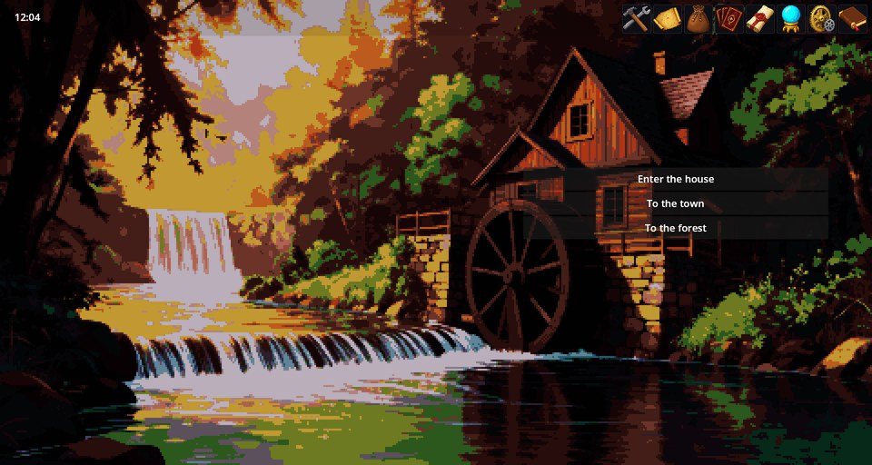
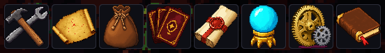
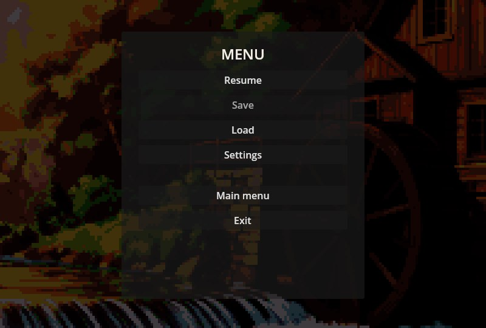

# UI — 所有游戏共用的界面

UI 是所有游戏共用的界面层：右上角的工具栏、游戏内菜单、存档指示器、左上角的通知，以及背景画面和面板、按钮、列表的统一外观。它自己没有剧情，也不定规则。几乎所有其他模组都构建在它之上，所以每个游戏里都有它，大量模组也把它列为依赖。



## 工具栏

每个图标都会打开一个面板。按钮并非固定不变：游戏中的每个模组都会加上自己的按钮，因此没有物品系统的小说游戏不会有背包，而带 Scenario Studio 的游戏则多出一个图标。



在 Cthangover 中，从左到右依次是：

1. **工具** — 开发者工具菜单（仅当游戏包含编辑器时出现）。
2. **地图** — 世界地图（Map Engine）。
3. **背包** — 物品栏（Items）。
4. **角色** — 队伍和角色（Characters）。
5. **招募者** — 已招募的角色（Recruiting）。
6. **技能** — 技能（Skills）。
7. **菜单** — 下文介绍的游戏内菜单（本模组）。
8. **日志** — 任务（Quests）。

其他游戏显示的按钮不同：例如 RPG Plus 会多出**角色面板**。

## 游戏内菜单

齿轮图标打开菜单：**继续**、**保存**、**读取**、**设置**、**主菜单**和**退出**。在不允许存档的场景中，“保存”会变灰，如图所示。“读取”“保存”和“设置”打开的窗口与主菜单中相同。



## 通知

左上角会出现简短消息：日志新增条目、剧情给出的提示等。同屏最多显示四条，每条停留约十秒，其余依次排队。


## 给模组作者

**添加工具栏按钮及其面板**：在 manifest.json 里写一个 `ui` 条目。Items 就是这样添加背包的：

```json
"ui": [
  {
    "id": "inventory",
    "kind": "panel",
    "slot": "ModBeforeUIPanel",
    "scene_path": "scenes/ui/inventory_panel.tscn",
    "button": { "icon": "bag", "locale": "ui/inventory/title", "index": 20 },
    "priority": 10
  }
]
```

- `button.index` 决定图标顺序（地图 10、背包 20、角色 30、技能 40、菜单 50、日志 60、工作室 90）；
- `button.icon` 是图标名，`button.locale` 是提示文字的翻译键；
- 不带 `button` 的条目是游戏自行打开的面板或覆盖层：Crafting 以 `"kind": "overlay"` 把工作台放进 `ModLastPanel` 槽位，并从剧本中打开它。

**从剧本打开面板**用 `ui.toggle_panel` 动作，**显示通知**用 `notify` 命令：

```scenario
notify "新的日志条目。"
```

**使用统一外观。** 用代码构建的面板会从组件库（`UiKit`）及其颜色、尺寸令牌中获取边框、文字、标签和按钮，因此新面板自然融入游戏整体风格并跟随主题变化。

## 出现问题时

1. **工具栏上少了按钮。** 添加它的模组不属于当前游戏；请在**模组与合集**中查看游戏的构成。
2. **“保存”是灰色的。** 当前场景不允许存档；换到别的地方再试。作者在场景任一剧本的头部写上 `save_allowed: true` 即可允许存档。
3. **面板打开了却是空的。** 对应模组在当前游戏中暂时没有内容可显示——例如还没有任务开始。
